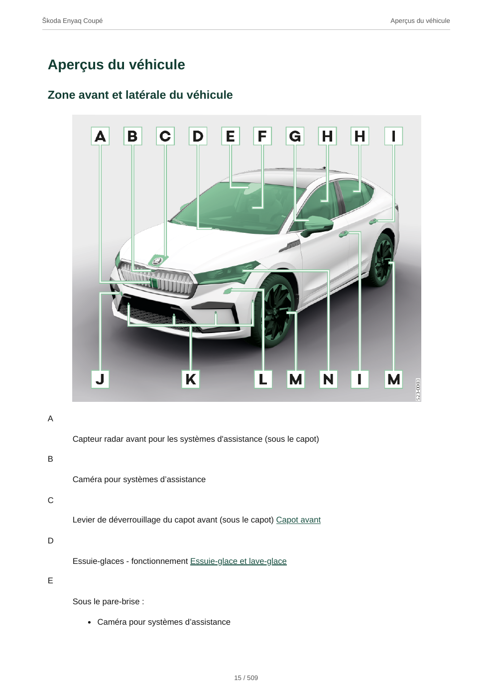

# Škoda Manual to PDF

Export the documentation Škoda returns for a VIN and language into one searchable PDF, with images, a clickable contents list and PDF bookmarks. Infotainment sections are included in the digital manual. Additional documents returned by the lookup are included, not inferred from another model/year.

## PDF preview

Sample page from a generated French Škoda Enyaq Coupé manual, showing illustrations, chapter headers and page numbering. No VIN is included in this preview.



Source manual text and illustrations © Škoda Auto a.s.

## Quick start

Install [uv](https://docs.astral.sh/uv/getting-started/installation/) (which includes `uvx`), then run this command from any directory:

```sh
uvx --from https://github.com/ahivert/skoda-manual-to-pdf/archive/refs/heads/main.zip skoda-manual
```

No Git installation, cloning, Python environment setup, or project installation is needed. `uvx` manages Python 3.11+ and the dependencies for you.

1. Enter your VIN privately when prompted (it stays out of your shell history).
2. If Chromium is missing, answer `y` to download it. Subsequent runs reuse it.
3. Choose a language. The PDF is saved in your current directory using the detected model and language, for example `skoda-enyaq-coupe-fr.pdf`.

The first run needs internet access and several hundred MB of disk space for Chromium. Installation is never attempted without consent.

## Options

```sh
# Choose French and a specific output filename.
uvx --from https://github.com/ahivert/skoda-manual-to-pdf/archive/refs/heads/main.zip skoda-manual --language fr --output manual-fr.pdf

# List the languages available for your VIN.
uvx --from https://github.com/ahivert/skoda-manual-to-pdf/archive/refs/heads/main.zip skoda-manual --list-languages
```

The default filename is `skoda-MODEL-LANGUAGE.pdf`, with accents and unsafe filename characters removed. `--output` overrides this name. Existing output files are never overwritten. The output directory must already exist.

## Troubleshooting

For non-interactive use, install the browser beforehand:

```sh
uvx --from https://github.com/ahivert/skoda-manual-to-pdf/archive/refs/heads/main.zip playwright install chromium
```

On Linux, if Chromium reports missing system libraries:

```sh
uvx --from https://github.com/ahivert/skoda-manual-to-pdf/archive/refs/heads/main.zip playwright install-deps chromium
```

System library installation may require administrator privileges. The CLI never installs system libraries or requests administrator access automatically.

To refresh the cached application after an update, add `--refresh` immediately after `uvx`.

## How it works

1. Query Škoda's manual catalogue for the VIN's languages and documents.
2. For digital manuals, launch an isolated headless Chromium instance, decline optional cookies, select the VIN and language on the official finder, and establish a session automatically.
3. Traverse the full contents tree and fetch each distinct topic and image, with at most four simultaneous requests. Repeated references point to one copy of the topic; there is no 100-section truncation.
4. Strip active HTML, embed images, and render with JavaScript and external network access disabled.
5. Combine the rendered manuals and any original PDFs returned by the catalogue into one PDF, then add running chapter headers and continuous page numbers across the complete document.

Digital manuals have a compact two-level contents list ("Sommaire" in French), with deeper topics retained in PDF bookmarks. The site's duplicate root index is removed without discarding introductory text. Major chapters start on new pages, and headings stay with their following content. Original PDFs retain their source layout.

No browser extension, account, copied cookies, proxy, or running backend is required. Chromium is a local CLI dependency, not a frontend website. Session cookies stay in memory and disappear when the browser closes. The VIN is sent to Škoda, not stored in configuration, and is not deliberately added to the generated PDF or filename. Source documentation may itself contain vehicle-specific information.

An unavailable chapter, image, or document aborts the export instead of silently generating an incomplete PDF. Downloaded content remains in memory; only the final PDF is saved. Failed runs must restart; caching and resume are intentionally omitted.

## Development

For contributors, from a local checkout:

```sh
uvx --with-editable . pytest tests -q
uvx ruff check skoda_manual.py tests
uvx --from build pyproject-build
```

Tests cover first-run browser installation prompts, VIN validation, complete tree traversal, safe image URLs, HTML cleanup, root-index removal, compact contents, expired-session errors, overwrite protection, and offline PDF rendering with bookmarks and links. Pagination tests check chapter boundaries, running headers and global numbering without losing PDF navigation. The PDF test requires the Chromium installation above but does not access the internet.

## Limitations

- Uses undocumented endpoints and the official finder's controls; Škoda changes can break exports.
- PDFs are reformatted for A4, not replicas of the website. Interactive features and videos are not embedded; visual completeness of every language has not been verified. Non-Latin languages depend on installed system fonts.
- Only documentation exposed by the VIN lookup/session is exported. This is not access to workshop/repair manuals or paid service documentation.
- Manuals remain Škoda's copyrighted material. Keep exports for personal use; do not publish generated manuals with the source code.

Reference: [jypma/skoda-manual](https://github.com/jypma/skoda-manual). This Python implementation establishes its own session rather than requiring manually copied cookies.
